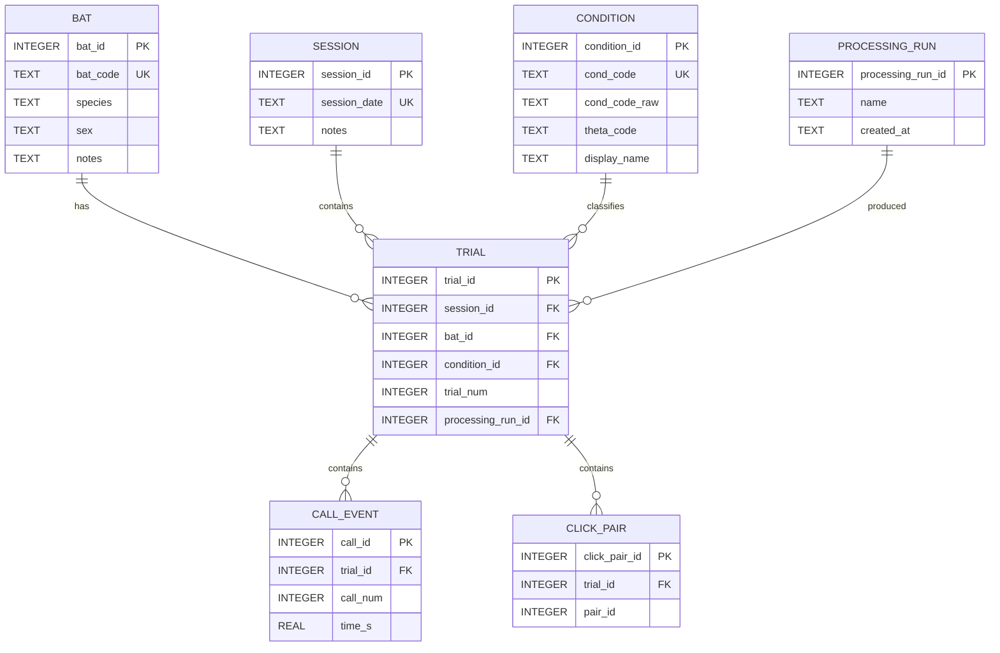

# Database schema

## Authority and inspection method

This document describes the schema actually present in the checked-in [batlab.db](./batlab.db), inspected with read-only SQLite metadata queries. There is no `CREATE TABLE` script, migration directory, schema version file, or database-initialization function in the repository. [sql_db_info.txt](./sql_db_info.txt) contains inspection queries, not schema definitions. [batlab.sqbpro](./batlab.sqbpro) is SQL Browser project metadata and includes a saved unique-index statement.

The database snapshot has `PRAGMA user_version = 0`, journal mode `delete`, and passed `PRAGMA integrity_check` with result `ok`. A direct read-only connection reported `PRAGMA foreign_keys = 0`; the application scripts explicitly enable foreign keys after connecting. This setting is per connection and is not a durable database property.

## Entity relationship diagram

The diagram shows declared relationships only. `call_event.pair_id` is a convenience field and is not a foreign key to `click_pair`; the database does not enforce that a pair row exists.

## Tables and constraints

### `bat`

Purpose: bat identity and optional descriptive metadata.

| Field | Type | Null/default | Key/constraint |
|---|---|---|---|
| `bat_id` | INTEGER | nullable declaration; primary-key row id | Primary key |
| `bat_code` | TEXT | NOT NULL | UNIQUE |
| `species` | TEXT | nullable | none |
| `sex` | TEXT | nullable; default `'U'` | CHECK in `('M','F','U')` |
| `notes` | TEXT | nullable | none |

### `session`

Purpose: recording date/session label. The schema makes the date globally unique.

| Field | Type | Null/default | Key/constraint |
|---|---|---|---|
| `session_id` | INTEGER | nullable declaration; primary-key row id | Primary key |
| `session_date` | TEXT | NOT NULL | UNIQUE; comment specifies `YYYY-MM-DD` |
| `notes` | TEXT | nullable | none |

### `condition`

Purpose: canonical experimental-condition lookup.

| Field | Type | Null/default | Key/constraint |
|---|---|---|---|
| `condition_id` | INTEGER | primary-key row id | Primary key |
| `cond_code` | TEXT | NOT NULL | UNIQUE; current values are `D`, `EM`, `EM-R1`, `G`, `L`, `R1`, `R2` |
| `cond_code_raw` | TEXT | nullable | optional raw code; not populated in the snapshot |
| `theta_code` | TEXT | nullable | optional code; no constraint |
| `display_name` | TEXT | nullable | optional display label |
| `plot_color` | TEXT | nullable | optional plotting value |
| `plot_palette` | TEXT | nullable | optional plotting value |
| `notes` | TEXT | nullable | none |

### `trial`

Purpose: one bat/session/condition trial and its optional provenance links.

| Field | Type | Null/default | Key/constraint |
|---|---|---|---|
| `trial_id` | INTEGER | primary-key row id | Primary key |
| `session_id` | INTEGER | NOT NULL | FK to `session.session_id`, `ON DELETE CASCADE` |
| `bat_id` | INTEGER | NOT NULL | FK to `bat.bat_id`, `ON DELETE RESTRICT` |
| `condition_id` | INTEGER | NOT NULL | FK to `condition.condition_id`, `ON DELETE RESTRICT` |
| `trial_num` | INTEGER | NOT NULL | part of unique trial identity |
| `vicon_trial_num` | INTEGER | nullable | optional external trial number |
| `mic_trial_num` | INTEGER | nullable | optional microphone trial number |
| `train_or_test` | TEXT | nullable | comment suggests `Training`/`Testing`; no CHECK |
| `landmark` | TEXT | nullable | optional landmark label |
| `source_file_path` | TEXT | nullable | optional source path; empty in snapshot |
| `processing_run_id` | INTEGER | nullable | FK to `processing_run.processing_run_id`, `ON DELETE SET NULL` |

Table-level UNIQUE constraint: (`session_id`, `bat_id`, `trial_num`, `condition_id`).

### `call_event`

Purpose: one call/click event and its derived position, vector, angle, interval, filtering, binning, and pairing fields. `time_s` and `trial_id` are required; most measurements are nullable.

| Field | Type | Field | Type |
|---|---|---|---|
| `call_id` | INTEGER PK | `trial_id` | INTEGER NOT NULL, FK |
| `call_num` | INTEGER | `time_s` | REAL NOT NULL |
| `good_call` | INTEGER | `behind` | INTEGER |
| `x_call`, `y_call`, `z_call` | REAL | `x`, `y`, `z` | REAL |
| `s` | REAL | `first_trip_s` | REAL |
| `trip` | INTEGER | `lon` | REAL |
| `long_angle_to_target` | REAL | `lon_angle_to_target` | REAL |
| `lon_angle_to_target_medfiltered` | REAL | `norm_hd_x`, `norm_hd_y`, `norm_hd_z` | REAL |
| `norm_hd_2d_x`, `norm_hd_2d_y` | REAL | `norm_beam_aim_vec_x`, `norm_beam_aim_vec_y`, `norm_beam_aim_vec_z` | REAL |
| `norm_beam_aim_vec_2d_x`, `norm_beam_aim_vec_2d_y` | REAL | `lon_beam`, `lat_beam` | REAL |
| `lon_head`, `lat_head` | REAL | `lon_aim_to_head`, `lat_aim_to_head` | REAL |
| `inter_click_interval` | REAL | `inter_click_distance_3D`, `inter_click_distance_2D` | REAL |
| `hd_sd_rad`, `hd_sd_deg` | REAL | `hd_sd_medianfiltered_rad`, `hd_sd_medianfiltered_deg` | REAL |
| `binned_s`, `binned_s_all` | REAL | `inter_click_interval_bcfiltered` | REAL |
| `inter_click_distance_3D_bcfiltered`, `inter_click_distance_2D_bcfiltered` | REAL | `lon_aim_to_head_bcfiltered`, `lat_aim_to_head_bcfiltered` | REAL |
| `lon_beam_bcfiltered`, `lat_beam_bcfiltered` | REAL | `lon_head_bcfiltered`, `lat_head_bcfiltered` | REAL |
| `hd_sd_bcfiltered` | REAL | `pair_id` | INTEGER |
| `pair_click_angle_lon`, `pair_click_angle_lat` | REAL | `pair_id_binned`, `pair_id_binned_all` | REAL |
| `pair_click_angle_lon_bcfiltered`, `pair_click_angle_lat_bcfiltered` | REAL |  |  |

Constraints and indexes:

- FK `trial_id -> trial.trial_id`, `ON DELETE CASCADE`.
- CHECK `good_call IN (0,1)` when non-null.
- CHECK `behind IN (0,1)` when non-null.
- UNIQUE (`trial_id`, `time_s`).
- Unique index `ux_call_trial_callnum` on (`trial_id`, `call_num`).
- Indexes `idx_call_trial_time` on (`trial_id`, `time_s`), `idx_call_pair` on (`trial_id`, `pair_id`), and `idx_call_good` on (`good_call`).

### `click_pair`

Purpose: optional trial-level pair summary. It is empty in the inspected snapshot.

| Field | Type | Null/default | Key/constraint |
|---|---|---|---|
| `click_pair_id` | INTEGER | primary-key row id | Primary key |
| `trial_id` | INTEGER | NOT NULL | FK to `trial.trial_id`, `ON DELETE CASCADE` |
| `pair_id` | INTEGER | NOT NULL | part of unique pair identity |
| `binned_s_all` | REAL | nullable | no unit definition supplied |
| `pair_id_binned_all` | REAL | nullable | no definition supplied |
| `pair_click_angle_lon` | REAL | nullable | no unit definition supplied |
| `pair_click_angle_lat` | REAL | nullable | no unit definition supplied |
| `inter_click_interval_bcfiltered` | REAL | nullable | name suggests an interval; unit not separately documented |

UNIQUE constraint: (`trial_id`, `pair_id`). Index `idx_pair_trial_pair` covers the same lookup columns.

### `processing_run`

Purpose: intended processing/provenance recipe registry. It is empty in the inspected snapshot.

| Field | Type | Null/default | Key/constraint |
|---|---|---|---|
| `processing_run_id` | INTEGER | primary-key row id | Primary key |
| `name` | TEXT | nullable | none |
| `description` | TEXT | nullable | none |
| `created_at` | TEXT | nullable; default `datetime('now')` | no timezone requirement stated |

### `binning_scheme`

Purpose: intended record of binning method and parameters. It is empty in the inspected snapshot.

| Field | Type | Null/default | Key/constraint |
|---|---|---|---|
| `binning_scheme_id` | INTEGER | primary-key row id | Primary key |
| `name` | TEXT | NOT NULL | UNIQUE |
| `variable` | TEXT | NOT NULL | none |
| `method` | TEXT | NOT NULL | comment suggests `cut` or `qcut`; no CHECK |
| `params_json` | TEXT | nullable | intended JSON string; not validated as JSON |
| `notes` | TEXT | nullable | none |

## Relationship and integrity assessment

The declared hierarchy is `session`/`bat`/`condition` -> `trial` -> `call_event` and optional `click_pair`. Cascading deletes can remove all calls and pair summaries for a deleted session or trial; bat and condition deletion is restricted; deleting a processing run nulls the trial link. No triggers or views were found.

The inspected snapshot has useful primary keys, natural-key uniqueness for several lookup tables, trial-level uniqueness, call-level uniqueness, and indexes that support the viewer queries. Representative query plans used the expected bat/session/trial/call indexes. Current read-only checks found no nulls in required columns, no duplicate candidates for declared keys, no foreign-key violations, and an `integrity_check` result of `ok`.

The design is not yet sufficient for reliable multi-experiment or multi-institution research management. `session_date` and `bat_code` are globally unique, there is no experiment/laboratory/institution/researcher identity, and the available provenance tables are empty and not populated by the importer. Retain the current design as a compatibility baseline; do not redesign it until representative use cases, migration policy, and controlled tests are approved.
